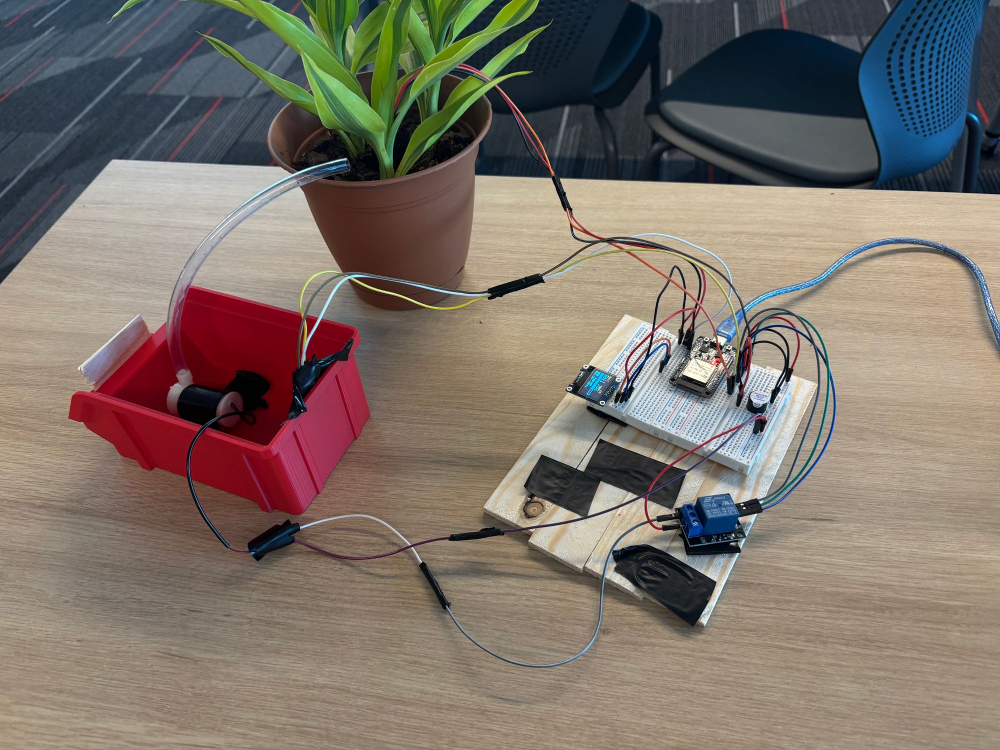
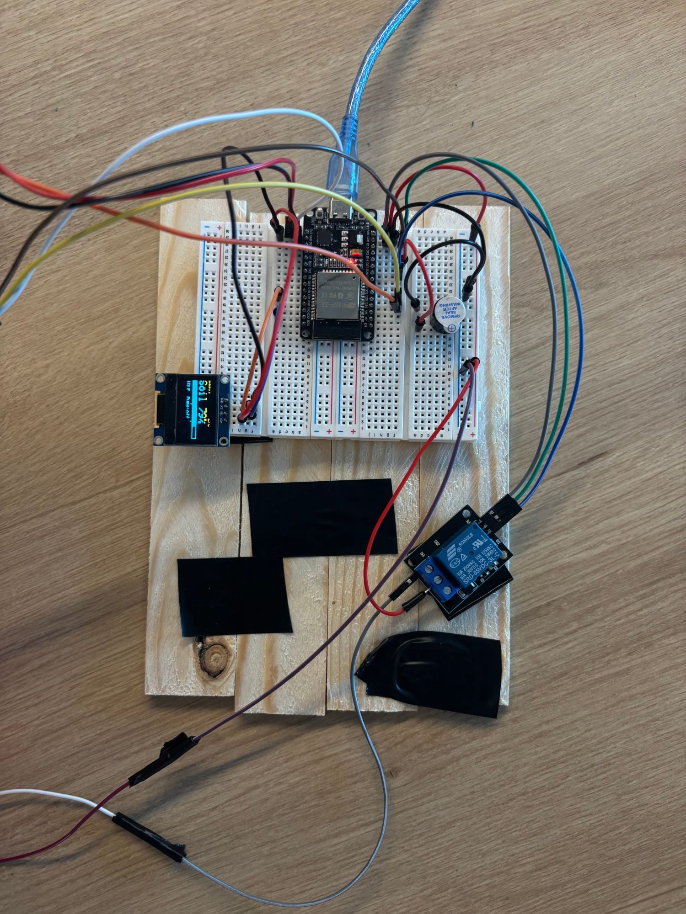
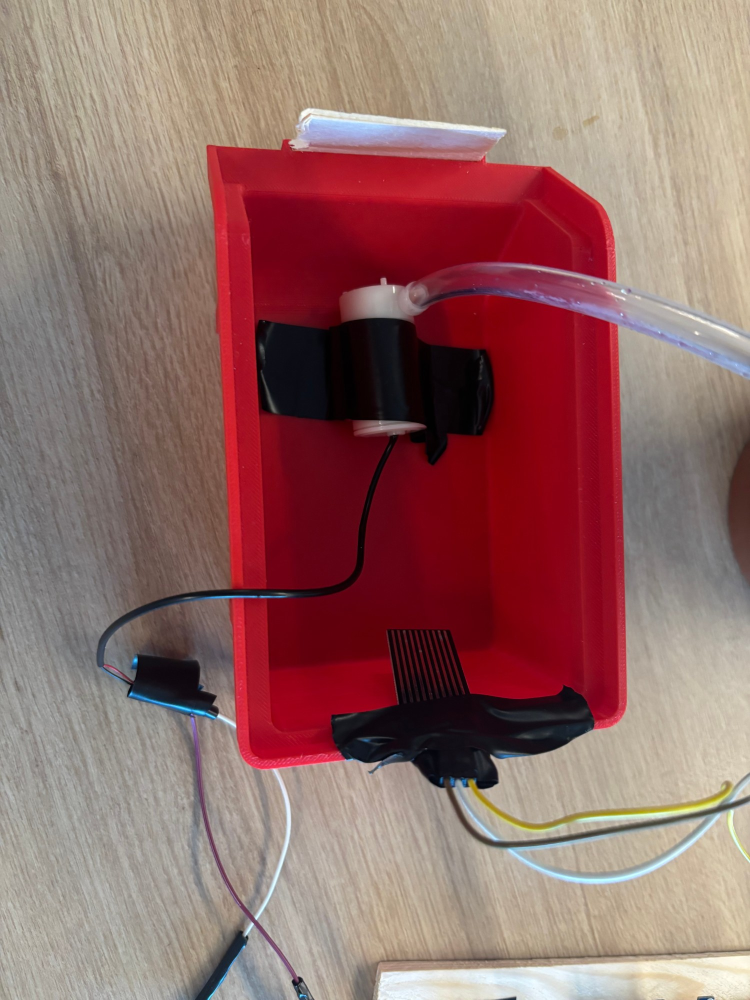
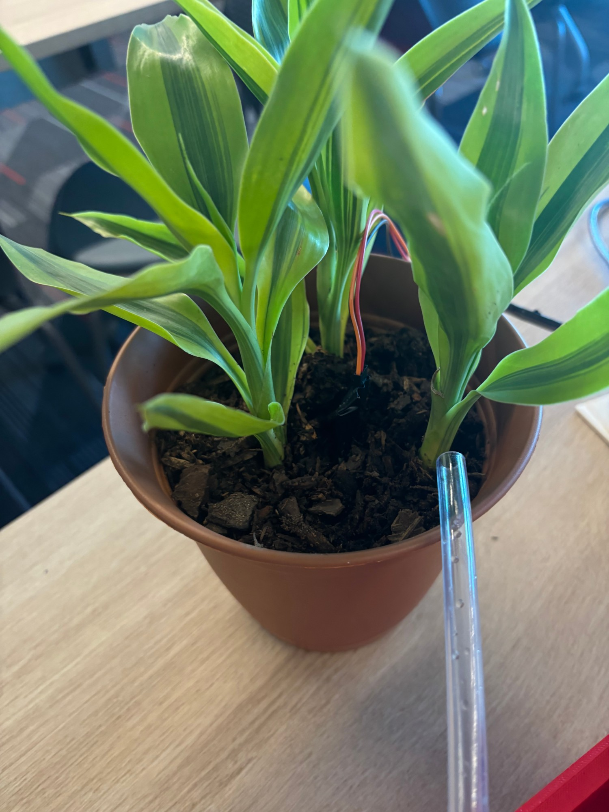

# Hardware

## Parts
ESP32 dev board (30-pin), Keyestudio soil moisture sensor, Keyestudio water level sensor, 1-channel 5 V relay (active-HIGH), submersible DC pump with its own supply, SSD1306 128x64 OLED (I2C 0x3C), active buzzer.

## Wiring
| Part | Pin | ESP32 |
|---|---|---|
| Soil sensor | S / V / G | D34 / 3V3 / GND |
| Level sensor | S / V / G | D35 / 3V3 / GND |
| Relay header | S / + / - | D26 / VIN (5 V) / GND |
| OLED | SDA / SCL / VCC / GND | D21 / D22 / 3V3 / GND |
| Buzzer | + / - | D27 / GND |

Relay screws: pump supply (+) to **COM**, **NO** to pump red wire, pump black wire to supply (-). All grounds on the ESP32 side must be common.

## Photos

**Electronics board:** ESP32, OLED, buzzer and relay on the breadboard.

**Tank:** submersible pump taped in a bin, with the water level sensor at the bottom.

**Plant:** the soil probe sits in the soil and the clear tube delivers water to the pot.

## Safety
Keep water away from the electronics and run `firmware/RelayTest` first to confirm relay polarity before connecting the pump. D34 and D35 are input-only ADC1 pins, which keeps readings usable while Wi-Fi is on.
